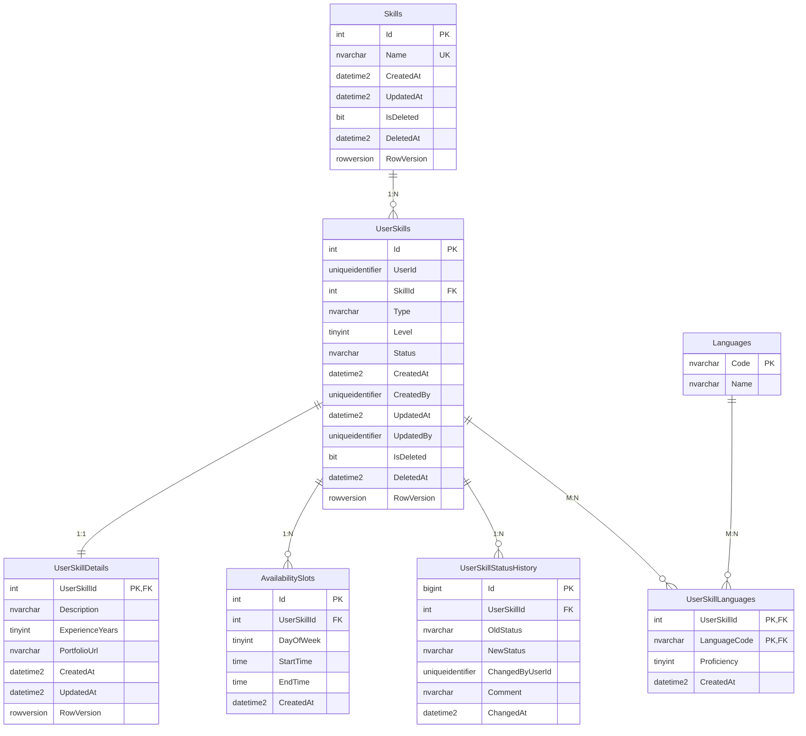
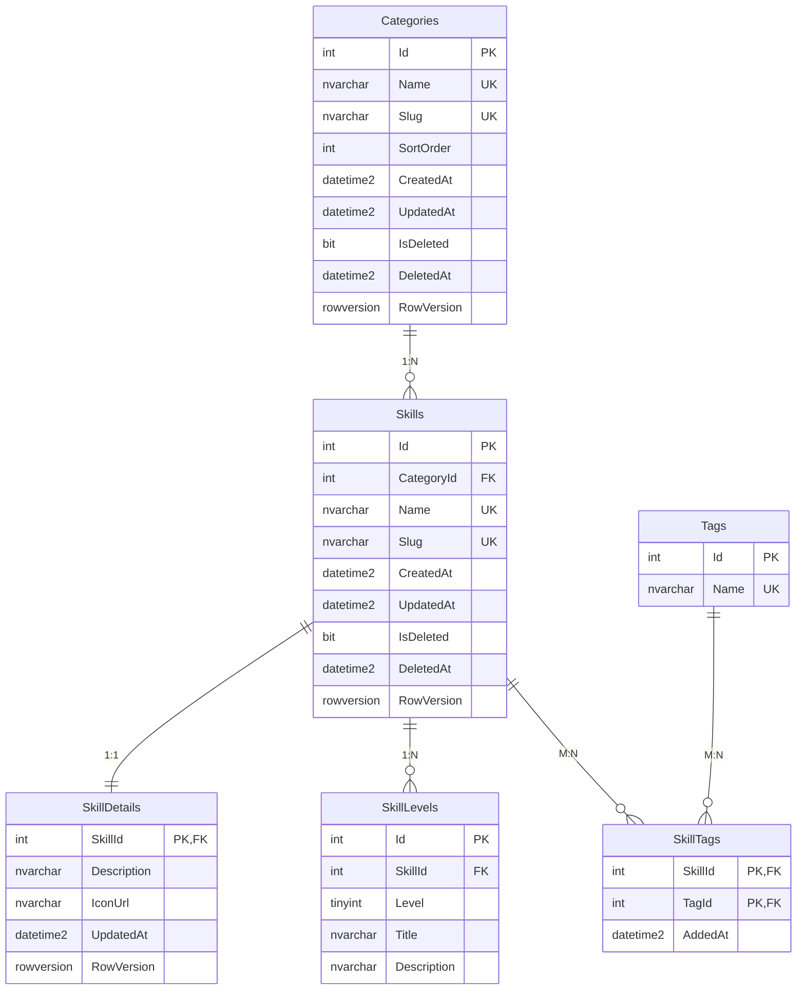

# QPQ (Quid pro quo)

Платформа обміну навичками: користувачі пропонують свої навички та домовляються про обмін з іншими.

## Предметна область і контексти

Домен розбито на три піддомени, у кожному по три API. Кожен API має власну базу даних.

| Піддомен | API |
|---|---|
| Skills | Catalog, UserSkills, Matching |
| Swaps | Swaps, Sessions, Messages |
| Reviews | Reviews, Reputation, Moderation |

Персональні дані (ім'я, email, аватар) зберігає зовнішній сервіс Identity (Duende IdentityServer / Keycloak). Він видає `UserId` (claim `sub`), а доменні сервіси зберігають лише цей ідентифікатор.

### Піддомен Swaps: три незалежні контексти

| Контекст | Сховище | База | Сутності, якими він володіє |
|---|---|---|---|
| Swaps (Проєкт №1) | SQL Server, ADO.NET + Dapper | `QPQ_Swaps` | Swap, SwapDetails, SwapSkill, SwapStatusHistory |
| Sessions (Проєкт №2) | SQL Server, EF Core | `QPQ_Sessions` | Session, SessionSkill, SessionOutcome, SessionFormat (довідник) |
| Messages (Проєкт №3) | MongoDB | `QPQ_Messages` | conversations, messages, attachments |

Кожна сутність належить рівно одному контексту. Таблиці `Skills` (у Swaps і Sessions), `AcceptedSwaps` (у Sessions) та колекція `conversations` (частково) є лише локальними копіями чужих даних, їх власник вказаний у політиці дублювання. Між базами немає FOREIGN KEY і спільних таблиць: зв'язок забезпечується ідентифікаторами та подіями.

## Політика дублювання даних

| Дані | Власник | Де зберігається копія | Що дублюється | Як підтримується узгодженість |
|---|---|---|---|---|
| Користувачі | Identity | ніде не дублюються | лише `UserId` (GUID) у полях `InitiatorId`, `PartnerId`, `CreatedBy`, `UpdatedBy`, `ChangedByUserId`, `CreatedByUserId`, `senderId`, `uploadedBy`, `participants.userId` | ім'я для відображення береться з токена або з Identity; подія `UserDeleted` очищає дані користувача |
| Навички | Catalog | Swaps (`Skills`) | `Id`, `Name` | подія `SkillChanged` оновлює локальну копію |
| Навички | Catalog | Sessions (`Skills`) | `Id`, `Name` | подія `SkillChanged` оновлює локальну копію |
| Прийнятий обмін | Swaps | Sessions (`AcceptedSwaps`) | `SwapId`, `InitiatorId`, `PartnerId`, `Status` | події `SwapAccepted` (створює копію) і `SwapCompleted` (оновлює статус) |
| Прийнятий обмін | Swaps | Messages (`conversations`) | `swapId`, `swapStatus`, `participants` (`userId`, `role`) | події `SwapAccepted` (створює розмову) і `SwapCompleted` (оновлює `swapStatus`) |
| Останнє повідомлення | Messages (`messages`) | Messages (`conversations.lastMessage`) | `messageId`, `senderId`, `preview`, `sentAt` | оновлюється разом із додаванням нового повідомлення |
| Назва вкладення | Messages (`attachments`) | Messages (`messages.attachments[].fileName`) | `fileName` | задається під час створення повідомлення, назва вкладення не змінюється |

## Розгортання баз даних

Вимоги: SQL Server LocalDB (входить до Visual Studio), `sqlcmd`, MongoDB та `mongosh`.

### Проєкт №1 (Swaps)

Скрипти запускають у такому порядку, кожен можна виконувати повторно:

1. `db/p1/schema.sql`: створює базу `QPQ_Swaps`, таблиці, обмеження та індекси;
2. `db/p1/procedures.sql`: створює 5 збережуваних процедур;
3. `db/p1/seed.sql`: додає тестові дані (повторний запуск не створює дублікатів).

```
sqlcmd -S "(localdb)\MSSQLLocalDB" -E -i db\p1\schema.sql
sqlcmd -S "(localdb)\MSSQLLocalDB" -E -i db\p1\procedures.sql
sqlcmd -S "(localdb)\MSSQLLocalDB" -E -i db\p1\seed.sql
```

### Проєкт №2 (Sessions)

1. `db/p2/schema.sql`: створює базу `QPQ_Sessions`, таблиці, обмеження та індекси;
2. `db/p2/seed.sql`: додає довідник форматів і тестові дані (повторний запуск не створює дублікатів).

```
sqlcmd -S "(localdb)\MSSQLLocalDB" -E -i db\p2\schema.sql
sqlcmd -S "(localdb)\MSSQLLocalDB" -E -i db\p2\seed.sql
```

### Проєкт №3 (Messages, MongoDB)

1. `db/p3/collections.js`: створює колекції з валідацією `$jsonSchema` та індекси в базі `QPQ_Messages`;
2. `db/p3/seed.js`: додає тестові дані (повторний запуск не створює дублікатів).

```
mongosh db\p3\collections.js
mongosh db\p3\seed.js
```

## Структура контекстів

ERD: [docs/erd-swaps.md](docs/erd-swaps.md). Опис контекстів: [docs/contexts.md](docs/contexts.md). Приклади документів MongoDB: [docs/document-examples.md](docs/document-examples.md).

### Swaps (`QPQ_Swaps`)

| Таблиця | Призначення | Зв'язок |
|---|---|---|
| Skills | локальна копія навичок з Catalog | M:N зі Swaps через SwapSkills |
| Swaps | заявка на обмін (`InitiatorId`, `PartnerId`, `Status`) | головна сутність |
| SwapDetails | деталі заявки | 1:1 зі Swaps |
| SwapSkills | навички заявки з роллю Offered/Requested | M:N з власним полем `Role` |
| SwapStatusHistory | журнал змін статусу | 1:N до Swaps |

Таблиця `Swaps` має аудитні колонки `CreatedAt`, `CreatedBy`, `UpdatedAt`, `UpdatedBy`, м'яке видалення (`IsDeleted`, `DeletedAt`) та `RowVersion` для оптимістичної конкурентності. Решта таблиць мають `CreatedAt`, а там, де можливе паралельне редагування, `UpdatedAt` і `RowVersion`.

#### Обмеження

| Тип | Приклади |
|---|---|
| PK | `Swaps.Id`, `SwapDetails.SwapId`, складений `SwapSkills (SwapId, SkillId, Role)` |
| FK | `SwapDetails → Swaps`, `SwapSkills → Swaps` і `→ Skills`, `SwapStatusHistory → Swaps` |
| UNIQUE | `UX_Skills_Name`: назва навички не повторюється серед активних |
| CHECK | допустимі статуси, `InitiatorId <> PartnerId`, роль `Offered/Requested`, `DurationMinutes > 0` |
| DEFAULT | `Status = 'Pending'`, `CreatedAt = SYSUTCDATETIME()`, `IsDeleted = 0` |

Каскадного видалення немає: усі FK мають `NO ACTION`. Обміни видаляються м'яко (`IsDeleted`), тому фізичне видалення не використовується, а історія статусів не повинна зникати разом із заявкою.

#### Індекси

| Індекс | Під який запит створено |
|---|---|
| `IX_Swaps_Initiator_Status` | `usp_GetUserSwaps` для ролі Initiator: відбір за `InitiatorId` і `Status`, сортування за `CreatedAt` (колонка в `INCLUDE`), лише активні записи |
| `IX_Swaps_Partner_Status` | те саме для ролі Partner |
| `IX_SwapSkills_Skill` | пошук обмінів за навичкою та перевірка FK під час оновлення навичок |
| `IX_SwapStatusHistory_Swap` | вибірка історії статусів конкретного обміну в хронологічному порядку |
| `UX_Skills_Name` | унікальність назв і пошук навички за назвою |

#### Збережувані процедури

| Процедура | Призначення |
|---|---|
| `usp_CreateSwap` | створення заявки в одній транзакції (Swaps, SwapDetails, SwapSkills, історія) |
| `usp_ChangeSwapStatus` | транзакційна зміна статусу з перевіркою прав, дозволених переходів і RowVersion; недопустимий перехід дає помилку 50012 |
| `usp_GetSwapById` | заявка з деталями та навичками |
| `usp_GetUserSwaps` | заявки користувача з фільтрами та пагінацією |
| `usp_SoftDeleteSwap` | м'яке видалення з перевіркою RowVersion |

Статуси: Pending, Accepted, Completed, Rejected, Cancelled.

### Sessions (`QPQ_Sessions`)

| Таблиця | Призначення | Зв'язок |
|---|---|---|
| SessionFormats | довідник форматів (Online, InPerson) | 1:N до Sessions |
| AcceptedSwaps | локальна копія прийнятих обмінів | 1:N до Sessions |
| Sessions | зустрічі в межах обміну | головна сутність |
| SessionOutcomes | підсумок проведеної зустрічі | 1:1 із Sessions |
| Skills | локальна копія навичок з Catalog | M:N із Sessions через SessionSkills |
| SessionSkills | навички, які розглядають на зустрічі, з полем `PlannedMinutes` | M:N з власним полем |

Довідник `SessionFormats` заповнюється в `seed.sql`. Статуси зустрічі: Planned, Completed, Cancelled.

#### Обмеження та індекси

| Тип | Приклади |
|---|---|
| UNIQUE | `UQ_SessionFormats_Code`, `UX_Skills_Name`, `UX_Sessions_Swap_Time` (не можна призначити дві зустрічі на один обмін в один час) |
| CHECK | `DurationMinutes > 0`, `PlannedMinutes > 0`, допустимі статуси, `CK_Sessions_Place` (для Online потрібне посилання, для InPerson місце) |
| DEFAULT | `Status = 'Planned'`, `DurationMinutes = 60`, `PlannedMinutes = 30` |
| Каскади | `NO ACTION` у всіх FK, зустрічі видаляються м'яко |

| Індекс | Під який запит створено |
|---|---|
| `IX_AcceptedSwaps_Initiator`, `IX_AcceptedSwaps_Partner` | пошук обмінів користувача для перевірки прав доступу до зустрічей |
| `IX_Sessions_Swap_ScheduledAt` | перелік зустрічей обміну за часом, лише активні |
| `UX_Sessions_Swap_Time` | заборона дублювання часу зустрічі в межах обміну |
| `IX_SessionSkills_Skill` | пошук зустрічей за навичкою |

### Messages (`QPQ_Messages`)

| Колекція | Призначення | Підхід |
|---|---|---|
| conversations | розмова за прийнятим обміном | вбудовані `participants` (масив піддокументів) і `lastMessage` (гібрид: знімок посилання); посилання на обмін через `swapId`; денормалізоване `swapStatus` |
| messages | повідомлення розмови | посилання на `conversationId`; три типи документів із різними наборами полів: `text`, `file`, `system` |
| attachments | файли розмови | окрема колекція, на яку посилаються повідомлення типу `file` через `attachments[].attachmentId` |

У повідомленнях типу `file` вкладення зберігаються гібридно: посилання `attachmentId` плюс вбудована назва `fileName`. Структуру документів перевіряє `$jsonSchema` (для `messages` через `oneOf` за типом): формат GUID, допустимі статуси та події, довжина тексту, не більше десяти вкладень.

| Індекс | Під який запит створено |
|---|---|
| `ux_conversations_swap` (унікальний) | одна розмова на обмін, пошук розмови за `swapId` |
| `ix_conversations_participant` | список розмов користувача |
| `ix_messages_conversation_createdAt` | хронологічна стрічка повідомлень розмови, без видалених |
| `ix_messages_sender_createdAt` | повідомлення конкретного відправника |
| `ix_attachments_conversation_uploadedAt` | файли розмови від нових до старих |

---

## QPQ (Quid pro quo): піддомен Skills

Платформа обміну навичками: користувачі пропонують свої навички та домовляються про обмін з іншими. Піддомен Skills відповідає за те, які навички існують, хто що пропонує чи хоче вивчити і хто кому підходить для обміну.

### Предметна область і контексти

Великий домен розбито на три піддомени, у кожному по три API. Кожен API має власну базу даних. Потік даних: Skills → Swaps → Reviews. Цей репозиторій містить реалізацію баз піддомену Skills.

| Піддомен | API |
|---|---|
| Skills | Catalog, UserSkills, Matching |
| Swaps | Swaps, Sessions, Messages |
| Reviews | Reviews, Reputation, Moderation |

Персональні дані (ім'я, email, аватар) зберігає зовнішній сервіс Identity (Duende IdentityServer / Keycloak). Він видає `UserId` (claim `sub`), а доменні сервіси зберігають лише цей ідентифікатор.

#### Піддомен Skills: три незалежні контексти

| Контекст | Сховище | База | Сутності, якими він володіє |
|---|---|---|---|
| UserSkills (Проєкт №1) | SQL Server, ADO.NET + Dapper | `QPQ_UserSkills` | UserSkill, UserSkillDetail, AvailabilitySlot, UserSkillLanguage, UserSkillStatusHistory, Language (довідник) |
| Catalog (Проєкт №2) | SQL Server, EF Core | `QPQ_Catalog` | Category, Skill, SkillDetail, SkillLevel, Tag, SkillTag |
| Matching (Проєкт №3) | MongoDB | `QPQ_Matching` | userSkillIndex, matches, skillStats |

Вибір сховища: UserSkills має життєвий цикл записів (Active, Paused, Archived) із контрольованими переходами, тому йому потрібні транзакційні процедури (Dapper). Catalog має багато сутностей і зв'язків різних типів, зручних для EF Core (Code First, міграції). Matching є read-моделлю з вкладеними масивами та документами різної форми, тому йому підходить MongoDB.

Кожна сутність належить рівно одному контексту. Таблиця `Skills` у UserSkills та колекції `userSkillIndex` (копія записів UserSkills; `skillName` з Catalog) і `skillStats` (похідні лічильники) є лише локальними копіями чужих даних; їх власники вказані в політиці дублювання. Між базами немає FOREIGN KEY і спільних таблиць: зв'язок забезпечується ідентифікаторами та подіями.

Навички `SkillId` 1-6 мають однакові ідентифікатори в усіх базах QPQ (Skills, Sessions та Swaps використовують ті самі seed-довідники), так само як користувачі U1-U4 в усіх seed-скриптах.

### Політика дублювання даних

| Дані | Власник | Де зберігається копія | Що дублюється | Як підтримується узгодженість |
|---|---|---|---|---|
| Користувачі | Identity | ніде не дублюються | лише `UserId` (GUID) у полях `UserSkills.UserId`, `CreatedBy`, `UpdatedBy`, `ChangedByUserId`, `userSkillIndex.userId`, `matches.userIds`, `offer.fromUserId`, `offer.toUserId` | ім'я для відображення береться з токена або з Identity; подія `UserDeleted` очищає дані користувача (UserSkills м'яко видаляє записи, Matching видаляє документи) |
| Навички | Catalog | UserSkills (`Skills`) | `Id`, `Name` | подія `SkillChanged` оновлює локальну копію |
| Навички | Catalog | Matching (`userSkillIndex.skillName`, `skillStats.skillName`) | `skillName` | подія `SkillChanged` оновлює назву в усіх документах навички |
| Навички | Catalog | Matching (`matches.offer.skillName`, `counterOffer.skillName`) | `skillName` | знімок на момент підбору, не оновлюється: пари тимчасові (TTL `expiresAt`) |
| Навичка користувача | UserSkills | Matching (`userSkillIndex`) | `userSkillId`, `userId`, `skillId`, `type`, `level`, `status`, `languages` (`code`, `proficiency`), `availability`, `experienceYears` (лише Offer) | подія `UserSkillsChanged` створює, оновлює або видаляє документ; після неї перераховуються пари й `skillStats` |
| Рівень навички | Catalog (`SkillLevels`) | UserSkills (`UserSkills.Level`), Matching (`level`) | число 1..5 | єдина шкала 1..5 є контрактом між контекстами; назви рівнів беруться з Catalog і в інших базах не зберігаються |
| Мови | UserSkills (`Languages`) | Matching (`languages[].code`) | лише код мови | коди змінюються рідко; нові приходять із `UserSkillsChanged` |
| Лічильники навички | Matching (`userSkillIndex`) | Matching (`skillStats`) | `offersCount`, `wantsCount`, `topLanguages` | похідні дані, перераховуються агрегацією з `$merge` (запит 8 у `db/p3/matching.queries.js`) |
| Посилання на запис індексу | Matching (`userSkillIndex`) | Matching (`matches.offer.indexRef`) | посилання на запис індексу | посилання за `_id`, дані читаються через `$lookup` (запит 6) |

#### Події між сервісами

| Подія | Від | Кому | Навіщо |
|---|---|---|---|
| `UserRegistered` / `UserDeleted` | Identity | UserSkills, Matching | створити або очистити дані користувача |
| `SkillChanged` | Catalog | UserSkills, Matching | актуальні назви навичок |
| `UserSkillsChanged` | UserSkills | Matching | оновити підбір пар |

### Розгортання баз даних

Вимоги: SQL Server LocalDB (входить до Visual Studio), `sqlcmd`, MongoDB 5.2 або новіша та `mongosh`.

#### Проєкт №1 (UserSkills)

Скрипти запускають у такому порядку, кожен можна виконувати повторно:

1. `db/p1/userskills.schema.sql`: створює базу `QPQ_UserSkills`, таблиці, типи для табличних параметрів, обмеження та індекси;
2. `db/p1/userskills.procedures.sql`: створює 6 збережуваних процедур;
3. `db/p1/userskills.seed.sql`: додає тестові дані (повторний запуск не створює дублікатів);
4. `db/p1/userskills.checks.sql` (за бажанням): перевірочні запити, див. розділ «Перевірка».

```
sqlcmd -S "(localdb)\MSSQLLocalDB" -E -i db\p1\userskills.schema.sql
sqlcmd -S "(localdb)\MSSQLLocalDB" -E -i db\p1\userskills.procedures.sql
sqlcmd -S "(localdb)\MSSQLLocalDB" -E -i db\p1\userskills.seed.sql
```

#### Проєкт №2 (Catalog)

1. `db/p2/catalog.schema.sql`: створює базу `QPQ_Catalog`, таблиці, обмеження та індекси;
2. `db/p2/catalog.seed.sql`: додає категорії, навички, рівні, теги та зв'язки між ними (повторний запуск не створює дублікатів).

```
sqlcmd -S "(localdb)\MSSQLLocalDB" -E -i db\p2\catalog.schema.sql
sqlcmd -S "(localdb)\MSSQLLocalDB" -E -i db\p2\catalog.seed.sql
```

#### Проєкт №3 (Matching, MongoDB)

1. `db/p3/matching.collections.js`: створює колекції з валідацією `$jsonSchema` та індекси в базі `QPQ_Matching`;
2. `db/p3/matching.seed.js`: додає тестові дані (повторний запуск не створює дублікатів).

```
mongosh db\p3\matching.collections.js
mongosh db\p3\matching.seed.js
```

#### Перевірка

Після розгортання можна перевірити вимоги лабораторної:

```
sqlcmd -S "(localdb)\MSSQLLocalDB" -E -i db\p1\userskills.checks.sql
sqlcmd -S "(localdb)\MSSQLLocalDB" -E -i db\p2\catalog.checks.sql
mongosh db\p3\matching.queries.js
```

`db/p1/userskills.checks.sql` і `db/p2/catalog.checks.sql` виводять усі зовнішні ключі бази (усі посилання лише на таблиці своєї бази), індекси та CHECK-обмеження. `db/p1/userskills.checks.sql` також викликає процедури зі свідомо неправильними даними: недопустимий перехід статусу, користувач без прав, застаріла `RowVersion`, дубль живого запису (кожна ситуація завершується керованою помилкою), показує CRUD, пошук із пагінацією та порівнює кількість рядків після повторного запуску seed. Сценарії, що змінюють дані, виконуються в транзакції з `ROLLBACK`.

`db/p3/matching.queries.js` показує, що документи `userSkillIndex` мають різні набори полів, пошук за вбудованими масивами, підбір взаємних пар, пагінацію, агрегації (`$group`, `$lookup`, `$merge`) і відхилення неправильного документа валідацією `$jsonSchema`.

### Структура контекстів

ERD: [docs/skills-erd.md](docs/skills-erd.md). Опис контекстів: [docs/skills-contexts.md](docs/skills-contexts.md). Приклади документів MongoDB: [docs/skills-document-examples.md](docs/skills-document-examples.md).

#### UserSkills (`QPQ_UserSkills`)

| Таблиця | Призначення | Зв'язок |
|---|---|---|
| Skills | локальна копія навичок з Catalog | 1:N до UserSkills |
| Languages | довідник мов | M:N з UserSkills через UserSkillLanguages |
| UserSkills | навичка користувача (`UserId`, `Type` Offer/Want, `Level`, `Status`) | головна сутність |
| UserSkillDetails | опис, досвід, портфоліо | 1:1 з UserSkills |
| AvailabilitySlots | вікна доступності за днями тижня | 1:N до UserSkills |
| UserSkillLanguages | мови навчання з рівнем володіння | M:N з власним полем `Proficiency` |
| UserSkillStatusHistory | журнал змін статусу | 1:N до UserSkills |

##### ERD



Таблиця `UserSkills` має аудитні колонки `CreatedAt`, `CreatedBy`, `UpdatedAt`, `UpdatedBy`, м'яке видалення (`IsDeleted`, `DeletedAt`) та `RowVersion` для оптимістичної конкурентності. Решта таблиць мають `CreatedAt`, а там, де можливе паралельне редагування (`UserSkillDetails`), ще `UpdatedAt` і `RowVersion`.

##### Первинні ключі та конкурентність

| Ключ | Тип | Обґрунтування |
|---|---|---|
| `UserSkills.Id` | `INT IDENTITY` | записи створює один сервіс через `usp_AddUserSkill`, тож ключ можна видати на стороні бази; послідовна вставка не фрагментує кластеризований індекс, вузький ключ робить компактними FK у чотирьох дочірніх таблицях; діапазону `INT` достатньо |
| `UserSkillStatusHistory.Id` | `BIGINT IDENTITY` | журнал росте швидше за самі записи (кілька рядків на кожен), тому з запасом |
| `Skills.Id` | `INT` без `IDENTITY` | це копія з Catalog: ідентифікатор видає власник даних, і він однаковий у всіх базах |
| `Languages.Code` | `NVARCHAR(10)` | природний ключ (`uk`, `en`), стабільний і зрозумілий у запитах |
| `UserId` у `UserSkills.UserId` та інших | `UNIQUEIDENTIFIER` | ідентифікатор генерує зовнішній Identity (claim `sub`), тобто ключі створюються поза нашою базою; тут це звичайні стовпці без FK |
| `UserSkillLanguages (UserSkillId, LanguageCode)`, `UserSkillDetails.UserSkillId` | складений / PK = FK | природні ключі зв'язку M:N і 1:1: дубль мови для запису неможливий |

Конкурентність оптимістична (`RowVersion`), бо один запис редагує лише його власник і конфлікти рідкісні (дві вкладки, два пристрої), тож блокувати рядок на час редагування в інтерфейсі недоцільно. Клієнт отримує `RowVersion` з `usp_GetUserSkillById` і передає її в `usp_ChangeUserSkillStatus`, `usp_UpdateUserSkill` і `usp_SoftDeleteUserSkill`; якщо рядок уже змінили, процедура повертає помилку 50011 і нічого не затирає. Усередині процедур перевірка стану й оновлення виконуються під `UPDLOCK, HOLDLOCK`, щоб між ними не вклинилася інша транзакція.

##### Обмеження

| Тип | Приклади |
|---|---|
| PK | `UserSkills.Id`, `UserSkillDetails.UserSkillId`, складений `UserSkillLanguages (UserSkillId, LanguageCode)` |
| FK | `UserSkills → Skills`, `UserSkillDetails`, `AvailabilitySlots`, `UserSkillStatusHistory → UserSkills`, `UserSkillLanguages → UserSkills` і `→ Languages` |
| UNIQUE | `UX_Skills_Name` (назва навички не повторюється серед активних), `UX_UserSkills_Live` (користувач не може мати два живих записи з однаковою навичкою й типом), `UQ_AvailabilitySlots_Slot` |
| CHECK | `Type IN (Offer, Want)`, `Level BETWEEN 1 AND 5`, допустимі статуси, `EndTime > StartTime`, `DayOfWeek BETWEEN 1 AND 7`, `Proficiency BETWEEN 1 AND 5`, `ExperienceYears <= 80` |
| DEFAULT | `Status = 'Active'`, `Level = 1`, `CreatedAt = SYSUTCDATETIME()`, `IsDeleted = 0`, `Proficiency = 3` |

Каскадного видалення немає: усі FK мають `NO ACTION`. Записи видаляються м'яко (`IsDeleted`), а історія статусів не повинна зникати разом із записом. Єдине фізичне видалення виконує `usp_UpdateUserSkill`: вона цілком замінює мови та вікна доступності в тій самій транзакції.

##### Індекси

| Індекс | Під який запит створено |
|---|---|
| `UX_UserSkills_Live` | унікальність живого запису: `(UserId, SkillId, Type)` лише для `IsDeleted = 0` і не `Archived`; після архівування навичку можна додати знову |
| `IX_UserSkills_User_Status` | `usp_GetUserSkills`: відбір за `UserId` і `Status`, колонки `SkillId`, `Type`, `Level`, `CreatedAt` у `INCLUDE`, лише активні записи |
| `IX_UserSkills_Skill_Type` | пошук активних пропозицій і бажань за навичкою (початкове наповнення Matching, перевірка попиту) |
| `IX_UserSkillLanguages_Language` | пошук записів за мовою навчання |
| `IX_UserSkillStatusHistory_UserSkill` | вибірка історії статусів конкретного запису в хронологічному порядку |
| `UX_Skills_Name` | унікальність назв і пошук навички за назвою |

##### Збережувані процедури

| Процедура | Призначення |
|---|---|
| `usp_AddUserSkill` | додавання навички однією транзакцією (UserSkills, деталі, мови, доступність, історія); мови й вікна передаються табличними параметрами |
| `usp_ChangeUserSkillStatus` | транзакційна зміна статусу з перевіркою власника, дозволених переходів і RowVersion; недопустимий перехід дає помилку 50012 |
| `usp_GetUserSkillById` | запис з деталями, мовами та доступністю (чотири набори результатів) |
| `usp_GetUserSkills` | навички користувача з фільтрами за типом і статусом та пагінацією |
| `usp_UpdateUserSkill` | оновлення рівня, деталей, мов і доступності з перевіркою власника, статусу та RowVersion |
| `usp_SoftDeleteUserSkill` | м'яке видалення власником з перевіркою RowVersion |

Статуси: Active, Paused, Archived. Допустимі переходи: Active → Paused, Active → Archived, Paused → Active, Paused → Archived. Archived є кінцевим статусом.

| Код помилки | Значення |
|---|---|
| 50002 | навичку не знайдено або видалено |
| 50010 | запис не знайдено |
| 50011 | конфлікт паралельного редагування (`RowVersion`) |
| 50012 | недопустимий перехід статусу |
| 50013 | архівний запис не можна редагувати |
| 50014 | дію може виконати лише власник |
| 50020 | неправильний тип (не Offer і не Want) |
| 50021 | така навичка вже є в списку користувача |
| 50023 | невідомий код мови |
| 50030 | неправильні параметри пагінації |

#### Catalog (`QPQ_Catalog`)

| Таблиця | Призначення | Зв'язок |
|---|---|---|
| Categories | категорії навичок | 1:N до Skills |
| Skills | довідник навичок (SkillId у всіх контекстах) | головна сутність |
| SkillDetails | опис і піктограма | 1:1 зі Skills |
| SkillLevels | назви рівнів 1..5 для навички | 1:N до Skills |
| Tags | теги для пошуку | M:N зі Skills через SkillTags |
| SkillTags | зв'язок навички з тегом і датою додавання | M:N з власним полем `AddedAt` |

##### ERD



Довідник засіваний навичками з `SkillId` 1-6 (ті самі, що в інших контекстах QPQ). Схема готова до міграцій EF Core: ключі, унікальні індекси й CHECK відповідають тому, що в Лаб. 03 описується Fluent API.

##### Обмеження та індекси

| Тип | Приклади |
|---|---|
| UNIQUE | `UX_Categories_Name`, `UX_Categories_Slug`, `UX_Skills_Name`, `UX_Skills_Slug` (лише серед активних), `UQ_Tags_Name`, `UQ_SkillLevels_Skill_Level` |
| CHECK | `Level BETWEEN 1 AND 5`, slug записаний малими літерами (`CK_Skills_Slug`, `CK_Categories_Slug`) |
| DEFAULT | `SortOrder = 0`, `CreatedAt = SYSUTCDATETIME()`, `IsDeleted = 0`, `AddedAt = SYSUTCDATETIME()` |
| Каскади | `NO ACTION` у всіх FK, довідник видаляється м'яко |

Назва навички унікальна в усьому довіднику: копії в інших базах мають UNIQUE за `Name`, і дубль у власника ламав би їхню синхронізацію.

| Індекс | Під який запит створено |
|---|---|
| `IX_Skills_Category` | перелік навичок категорії (`Name`, `Slug` у `INCLUDE`), лише активні |
| `IX_SkillTags_Tag` | пошук навичок за тегом |
| `UX_Skills_Slug`, `UX_Categories_Slug` | відкриття сторінки за зрозумілою адресою |

#### Matching (`QPQ_Matching`)

| Колекція | Призначення | Підхід |
|---|---|---|
| userSkillIndex | копія записів UserSkills для підбору | вбудовані `languages` і `availability` (масиви піддокументів); два типи документів із різними наборами полів: `Offer` (з `experienceYears`) і `Want`; посилання на навичку через `skillId`; денормалізоване `skillName` |
| matches | знайдена пара | вбудовані `offer` і `counterOffer`; посилання на запис індексу через `offer.indexRef` разом зі знімком `skillName` (гібрид); два види документів: `oneWay` і `mutual` (з `counterOffer`); TTL за `expiresAt` |
| skillStats | лічильники навичок | похідна колекція, `_id = skillId`, вбудований масив `topLanguages`; перераховується агрегацією |

Структуру документів перевіряє `$jsonSchema` (для `userSkillIndex` і `matches` через `oneOf` за типом чи видом): формат GUID, допустимі значення, діапазон рівня, формат часу `HH:mm`, не більше десяти мов.

| Індекс | Під який запит створено |
|---|---|
| `ux_userSkillIndex_userSkillId` (унікальний) | один документ на запис UserSkills, оновлення за подією `UserSkillsChanged` |
| `ix_userSkillIndex_skill_type_active` (частковий, лише `Active`) | пошук активних пропозицій і бажань за навичкою |
| `ix_userSkillIndex_user_status` | усі записи користувача (видалення за `UserDeleted`, перегляд) |
| `ux_matches_offer` (унікальний) | одна пара на комбінацію «хто, кому, яку навичку» |
| `ix_matches_user_status_score` | список пар користувача за оцінкою без відкинутих |
| `ttl_matches_expiresAt` (TTL) | автоматичне видалення застарілих пар |

## Лабораторна 2: UserSkills (ADO.NET + Dapper)

Сервіс піддомену **Skills** `UserSkills`: які навички людина пропонує (`Offer`) чи хоче вивчити (`Want`), мови викладання та вікна доступності. База: `QPQ_UserSkills` (SQL Server). Повний опис, таблиця помилок і чекліст перед здачею: [Services/UserSkills/README.md](Services/UserSkills/README.md).

### Схема рішення

```
Platform.slnx                   одне рішення на всю платформу
Platform.AppHost/               оркестрація .NET Aspire
Services/UserSkills/
├── UserSkills.Domain           моделі, константи, доменні винятки
├── UserSkills.Dal              ADO.NET + Dapper, Unit of Work, SqlExceptionTranslator
├── UserSkills.Bll              DTO, AutoMapper, сервіси з транзакціями
├── UserSkills.Api              контролери, ProblemDetails, Swagger, Serilog
└── UserSkills.Tests            unit-тести BLL
```

Залежності: `Api -> Bll -> Dal`, `Domain` підключають `Dal` і `Bll`. SQL існує лише в `Dal` та в процедурах бази.

### Розгортання бази UserSkills

Скрипти ідемпотентні, запускати по черзі:

```
sqlcmd -S "<host>,<port>" -U <login> -C -f 65001 -i db/p1/userskills.schema.sql
sqlcmd -S "<host>,<port>" -U <login> -C -f 65001 -i db/p1/userskills.procedures.sql
sqlcmd -S "<host>,<port>" -U <login> -C -f 65001 -i db/p1/userskills.seed.sql
```

Для LocalDB: `-S "(localdb)\MSSQLLocalDB" -E` замість `-S ... -U ... -C`.

### Запуск через .NET Aspire

> Починаючи з Лаб. 05 базу UserSkills у контейнері створює й наповнює сам AppHost (див. розділ «Лаб. 05»); кроки з User Secrets нижче потрібні лише для запуску сервісу окремо від платформи.

1. Збережіть рядок підключення в User Secrets AppHost (пароль не потрапляє в git):

```
   cd Platform.AppHost
   dotnet user-secrets set "ConnectionStrings:UserSkillsDb" "Server=<host>,<port>;Database=QPQ_UserSkills;User Id=<login>;Password=<password>;Encrypt=True;TrustServerCertificate=True;"
```

   У `appsettings.json` лежить лише шаблон (LocalDB), реальне значення перекривають Aspire і User Secrets.

2. Запустіть AppHost:

```
   dotnet run --project Platform.AppHost
```

3. Відкрийте Aspire Dashboard за посиланням з консолі (`https://localhost:17100`): ресурс `userskills-api` має статус *Running*, посилання веде на Swagger (`https://localhost:7139/swagger`).

Користувач передається заголовком `X-User-Id` (у Swagger кнопка **Authorize**); у production його замінить claim `sub` з Identity.

### Приклади запитів (UserSkills)

```
curl -k -X POST https://localhost:7139/api/user-skills \
  -H "X-User-Id: 11111111-1111-1111-1111-111111111111" -H "Content-Type: application/json" \
  -d '{"skillId":1,"type":"Offer","level":4,"languages":[{"languageCode":"uk","proficiency":5}],"slots":[{"dayOfWeek":1,"startTime":"18:00","endTime":"20:00"}]}'

curl -k "https://localhost:7139/api/user-skills?type=Offer&status=Active&pageNumber=1&pageSize=20" \
  -H "X-User-Id: 11111111-1111-1111-1111-111111111111"

curl -k https://localhost:7139/api/user-skills/1 -H "X-User-Id: 11111111-1111-1111-1111-111111111111"

curl -k -X POST https://localhost:7139/api/user-skills/1/status \
  -H "X-User-Id: 11111111-1111-1111-1111-111111111111" -H "Content-Type: application/json" \
  -d '{"newStatus":"Paused","rowVersion":"<rowVersion з попередньої відповіді>"}'

curl -k https://localhost:7139/api/user-skills/999999 -H "X-User-Id: 11111111-1111-1111-1111-111111111111"   # 404, ProblemDetails
```

### Тести

```
dotnet test Services/UserSkills/UserSkills.Tests
```

---

## Лаб. 03: Catalog.Api (EF Core)

Сервіс Catalog піддомену Skills реалізовано на EF Core: Code First, Fluent API, міграції, Async Generic Repository + Unit of Work, DTO + AutoMapper, пагінація, фільтрація, сортування, FluentValidation, ProblemDetails, Serilog, Specification pattern. Код: `Services/Catalog/`, інструкція запуску й міграцій: [Services/Catalog/README.md](Services/Catalog/README.md), SQL-скрипт міграцій: [db/p2/catalog.ef-migrations.sql](db/p2/catalog.ef-migrations.sql).

## Лаб. 04: Matching (Clean Architecture, CQRS, MediatR, MongoDB)

Сервіс Matching піддомену Skills (Проєкт №3, база `QPQ_Matching`) переписано за шаблоном Clean Architecture: чотири проєкти з правильним напрямком залежностей, доменні сутності та Value Objects, команди й запити MediatR, наскрізна валідація через Pipeline Behaviors (FluentValidation), BSON-мапінг через `BsonClassMap`, оптимістична конкурентність (`version`, `ETag` / `If-Match`), централізована обробка помилок MongoDB, сідінг та індекси при старті. Код: `Services/Matching/`, схема шарів, запуск і чекліст перед здачею: [Services/Matching/README.md](Services/Matching/README.md).

## Лаб. 05: платформа на .NET Aspire (Gateway, Aggregator, ServiceDefaults)

Сервіси піддомену Skills (Лаб. 02–04) об'єднано в одну платформу: **усе запускається однією командою через AppHost**, клієнт ходить лише через Gateway, а в Aspire Dashboard один запит видно наскрізно — за trace і за CorrelationId.

```
Клієнт ─► gateway (YARP, :5000, генерує CorrelationId)
            ├─► catalog-api      /api/skills, /api/categories, /api/tags        (SQL Server, EF Core)
            ├─► userskills-api   /api/user-skills, /api/languages               (SQL Server, Dapper)
            ├─► matching-api     /api/matches, /api/index-entries, /api/skill-stats   (MongoDB)
            └─► aggregator       /api/aggregator/skills/{id}/full
                                   └─ Task.WhenAll ─► catalog-api · userskills-api · matching-api
```

| Компонент | Призначення |
|---|---|
| `Platform.AppHost` | оркестрація: контейнери SQL Server і MongoDB (`WithDataVolume`), реєстрація сервісів, `WithReference`/`WaitFor`, health checks |
| `Platform.ServiceDefaults` | Serilog (структуровані логи), OpenTelemetry (трасування й метрики), health checks, service discovery, resilience, CorrelationId |
| `Platform.ApiGateway` | єдина точка входу на YARP; маршрути за логічними іменами сервісів; логи маршрутизації й метрики |
| `Platform.Aggregator` | Aggregator Pattern: картка навички з трьох сервісів, часткові відповіді |

### Запуск

Потрібні .NET 10 SDK і Docker Desktop (або podman). Налаштовувати нічого не треба: після клонування працює локальний режим, пароль SQL Server Aspire генерує сам і зберігає в User Secrets AppHost на вашій машині (у репозиторії паролів немає):

```
dotnet run --project Platform.AppHost
```

Для podman перед запуском: `export ASPIRE_CONTAINER_RUNTIME=podman`. Dashboard відкривається за посиланням із консолі (за замовчуванням `https://localhost:17100`, профіль `http` — `http://localhost:15100`).
Порядок старту: бази → сервіси → Aggregator → Gateway (ланцюжки `WaitFor`; готовність визначає `/health`).

**За замовчуванням усе працює локально** — достатньо пароля SQL Server. Щоб перемкнути окрему базу на віддалений сервер (розробка/production), задайте її рядок підключення в User Secrets AppHost; без секрету використовується локальний контейнер:

```
dotnet user-secrets set "ConnectionStrings:UserSkillsDb" "<рядок підключення>" --project Platform.AppHost
dotnet user-secrets set "ConnectionStrings:CatalogDb"    "<рядок підключення>" --project Platform.AppHost
dotnet user-secrets set "ConnectionStrings:MatchingDb"   "<рядок підключення MongoDB>" --project Platform.AppHost
```

Якщо віддалений MongoDB працює лише по TLS із самопідписаним сертифікатом (наприклад, Coolify), додайте до рядка `?authSource=admin&tls=true&tlsInsecure=true`; демо-сід Matching для віддаленої бази вимкнено.

Для віддаленого SQL Server схему UserSkills (`db/p1`) розгортають вручну, Catalog створює схему міграціями сам; контейнер SQL Server (і пароль) не потрібні, якщо віддаленими є обидві SQL-бази. Для перевірки й здачі лабораторної секрети видаляють (`dotnet user-secrets remove ... --project Platform.AppHost`).

Локальні бази створюються автоматично: `CatalogDb` (`QPQ_CatalogEf`) — міграціями EF Core при старті Catalog, `UserSkillsDb` (`QPQ_UserSkills`) — скриптами `db/p1` (AppHost виконує їх, щойно база готова), `MatchingDb` (`QPQ_Matching`) — індексами й сідінгом Matching. Дані зберігаються між перезапусками (volumes).

> Пароль SQL Server зберігається в томі разом з даними: якщо видалити секрет `Parameters:sql-password` або змінити його після першого запуску, видаліть і том (`podman volume rm` / Docker Desktop → Volumes), інакше SQL Server не прийме новий пароль.

### Що змінено в сервісах Лаб. 02–04

Бізнес-логіку не змінено. У `Program.cs` кожного сервісу: `builder.AddServiceDefaults()` (замість власного `UseSerilog`), `app.UseMiddleware<CorrelationIdMiddleware>()` і `app.MapDefaultEndpoints()` (`/health`, `/alive`); рядки підключення читаються з `ConnectionStrings:<ім'я бази>`, а `appsettings.json` лишається резервним варіантом для запуску без Aspire.
Додатково: у Catalog з `RequestContextMiddleware` прибрано власну обробку CorrelationId (його додає спільний middleware); у Matching `MongoClient` підписується на `DiagnosticsActivityEventSubscriber`, щоб команди MongoDB потрапляли в trace, а `MapHealthChecks("/health")` замінено на `MapDefaultEndpoints()`.

### Перевірка

```
curl -i http://localhost:5000/api/skills/1                      # через Gateway; у відповіді X-Correlation-Id
curl -i http://localhost:5000/api/skills/1 -H "X-Correlation-Id: my-id-1"   # власний id зберігається
curl    http://localhost:5000/api/user-skills/by-skill/1
curl    http://localhost:5000/api/skill-stats/1
curl -i http://localhost:5000/api/aggregator/skills/1/full      # картка навички з трьох сервісів
```

- **Логи за CorrelationId:** Dashboard → Structured logs → фільтр `CorrelationId` (значення з заголовка відповіді) показує записи Gateway, Aggregator і сервісів. Кожен запис містить `ServiceName`, `EnvironmentName`, `MachineName`, `CorrelationId`, `TraceId`, `SpanId`.
- **Trace:** Dashboard → Traces → запит `GET /api/aggregator/...`: Gateway → Aggregator → паралельні виклики catalog-api, userskills-api, matching-api → spans SQL Server (Dapper, EF Core) і MongoDB.
- **Часткова відповідь:** зупиніть `matching-api` у Dashboard і повторіть запит до Aggregator — відповідь `200` містить навичку й записи користувачів, а в `warnings` — `matching-api is unavailable`. Після запуску сервісу відповідь знову повна. Неіснуюча навичка (`/skills/999/full`) дає `404` (без довідника агрегувати нічого).
- **Gateway ≠ просте проксі:** виклик напряму за внутрішньою адресою сервісу (з Dashboard) не містить CorrelationId, доки його не передасть клієнт; Gateway завжди додає його й логує маршрут, статус і тривалість.

### Примітки

- `/api/skills` належить Catalog; однойменний довідниковий ендпоінт UserSkills (`/api/skills`) через Gateway недоступний, зате доступні `/api/user-skills/*` і `/api/languages`.
- Resilience-політики (`AddStandardResilienceHandler`) налаштовано коротко (2 с на спробу, 5 с загалом), щоб недоступний сервіс швидко ставав попередженням; детально — Лаб. 07.
- Сервіси на HTTP, сертифікати dev-середовища не потрібні (`ASPIRE_ALLOW_UNSECURED_TRANSPORT=true` для профілю `http`).

## Лаб. 06: gRPC і кешування (IMemoryCache + Redis)

Платформу з Лаб. 05 розширено двома речами: **кешуванням** довідника Catalog (L1 — `IMemoryCache`, L2 — Redis) і **gRPC** для внутрішніх викликів: Aggregator тепер викликає сервіси через типізовані gRPC-клієнти, а для зовнішніх клієнтів REST лишається без змін (JSON-відповідь Aggregator не змінилась).

```
Клієнт ─► gateway ─► aggregator ──(Redis: aggregator:skill:{id}:full, TTL 30 с)
 (HTTP)                  └─ Task.WhenAll, gRPC / HTTP/2 ─► catalog-api     CatalogService.GetSkill      ─► L1 ─► L2 (Redis) ─► SQL
                                                        ├─► userskills-api UserSkillsService.ListBySkill ─► SQL
                                                        └─► matching-api   MatchingService.GetSkillStats ─► MongoDB
```

### Що де лежить

| Частина | Файли |
|---|---|
| Redis і gRPC-endpoint'и в оркестрації | `Platform.AppHost/AppHost.cs` — `AddRedis("redis").WithDataVolume()`, `WithReference(redis)`, `WaitFor`, endpoint `grpc` (`env: GRPC_PORT`) |
| gRPC-сервер, `LoggingInterceptor`, метрики | `Platform.ServiceDefaults/Grpc/*`, `Extensions.cs` (meter `Catalog.Cache`, `Aggregator.Cache`, `Grpc.*`) |
| Двохрівневий кеш Catalog | `Services/Catalog/Catalog.Bll/Caching/*` (`TwoLevelCache`, `CachedSkillService`, `CachedReferenceServices`, `CacheMetrics`) |
| Health check і прогрівання кешу | `Services/Catalog/Catalog.Api/Caching/*` |
| `.proto`-контракти | `Services/Catalog/Catalog.Api/Protos/catalog.proto`, `Services/UserSkills/UserSkills.Api/Protos/userskills.proto`, `Services/Matching/Matching.WebApi/Protos/matching.proto` |
| gRPC-сервіси | `*/Grpc/CatalogGrpcService.cs`, `UserSkillsGrpcService.cs`, `MatchingGrpcService.cs` — адаптери над бізнес-логікою Лаб. 02–04 |
| gRPC-клієнти Aggregator | `Platform.Aggregator/Program.cs` (`AddGrpcClient`), `Services/SkillAggregationService.cs`, `Services/AggregateCache.cs` |

### Кешування

- **Cache-aside** у декораторах над сервісами Catalog: `CachedSkillService`, `CachedCategoryService`, `CachedTagService`. Контролери й gRPC залежать від `ISkillService` і не знають про кеш, тому **REST і gRPC користуються одним кешем** без дублювання коду. Реєстрація — у `Program.cs`.
- **L1** — `IMemoryCache` із `SizeLimit = 10 000` (кожен запис має `Size`), absolute і sliding expiration, лічильник витіснень. **L2** — `IDistributedCache` поверх Redis (пакет `Aspire.StackExchange.Redis.DistributedCaching`, рядок підключення Aspire передає як `ConnectionStrings:redis`). DTO серіалізуються через `System.Text.Json`. Схему L1 → L2 → база з заповненням на зворотному шляху написано вручну (`TwoLevelCache`); готовий аналог у .NET — `HybridCache` (додатково захищає від одночасного перерахунку одного значення багатьма запитами й має інвалідацію за тегами), у цій роботі його не використано.
- **Ключі й TTL** (L1 завжди коротший за L2 — це правило перевіряє конструктор `CachePolicy`):

| Дані | Ключ | L1 | L2 |
|---|---|---|---|
| Картка навички | `catalog:skill:{id}` | 2 хв (sliding 45 с) | 10 хв |
| Сторінка списку навичок | `catalog:skills:list:{версія}:{хеш запиту}` | 30 с | 2 хв |
| Теги, категорії (довідники) | `catalog:tags:all`, `catalog:category:{id}`, `catalog:categories:list:…` | 2 хв | 30 хв |
| Картка навички в Aggregator | `aggregator:skill:{id}:full` | — | 30 с (коротше за кеші сервісів) |

- **Інвалідація синхронна з записом:** після `SaveChanges` видаляється ключ картки (L1 і Redis); списки переводяться на нову версію групи (`catalog:version:skills-list`) — старі сторінки просто перестають читатися. Зміна категорії інвалідує й картки її навичок (у них є назва категорії). Причину кожної інвалідації видно в логах (`reason`) і в метриці `cache.invalidations`.
- **Стійкість до збою Redis:** виняток або таймаут (500 мс) на L2 не валить запит — сервіс читає з L1 і бази, а L2 пропускається 15 с, щоб не гальмувати кожен виклик; `/health/cache` після першого збою L2 показує `Degraded` (`l2.available: false`). Health check Redis від Aspire при цьому робить загальний `/health` нездоровим (503), тому в Dashboard ресурс може позначитись як unhealthy, хоча сервіс відповідає. Aggregator у такому разі збирає відповідь заново. Часткову відповідь Aggregator (`warnings` не порожні) не кешує.
- **Прогрівання:** `CacheWarmupService` на старті й кожні 5 хв завантажує теги, категорії, першу сторінку навичок і їх картки (`Cache:Warmup:Enabled=false` вимикає).
- **Обмеження:** L1 однієї репліки не оновлюється при зміні даних на іншій реплікі — застаріла копія живе до кінця L1 TTL (максимум 2 хв); списки цього не мають, бо версія читається з Redis. Оновлення L1 через Redis pub/sub (необов'язковий пункт) не реалізовано.

### gRPC

- **Контракти** (`.proto`): package за предметною областю, `option csharp_namespace`, коментарі, нумерація полів; **номери полів після публікації не змінюються**. У сервісі проєкт підключає `<Protobuf Include="Protos\…" GrpcServices="Server" />`, в Aggregator — ті самі файли за відносним шляхом із `GrpcServices="Client"`.
- **Сервіси** перетворюють доменні моделі на повідомлення, а винятки — на `RpcException` зі статусом: відсутня сутність → `NotFound`, некоректні параметри → `InvalidArgument` (не загальний `Internal`).
- **HTTP/2 без TLS:** узгодження протоколу через ALPN потребує TLS, тому кожен сервіс слухає **два порти** — REST (HTTP/1.1) і окремий gRPC-endpoint `grpc` лише з HTTP/2. AppHost оголошує endpoint (`WithHttpEndpoint(name: "grpc", env: "GRPC_PORT")`), `AddGrpcServerDefaults()` у ServiceDefaults підіймає Kestrel-listener на цьому порту. Без `GRPC_PORT` (запуск поза AppHost) конфігурація Kestrel не змінюється.
- **Клієнти Aggregator:** `AddGrpcClient<…>(o => o.Address = new Uri("http://_grpc.catalog-api"))` — префікс `_grpc.` вибирає іменований endpoint при service discovery. Клієнти створює та сама фабрика `HttpClient`, тому resilience, service discovery і `CorrelationIdHandler` з ServiceDefaults діють і для gRPC (`X-Correlation-Id` іде в метаданих виклику). Три виклики йдуть паралельно (`Task.WhenAll`) із `CancellationToken` і deadline 3 с; недоступність userskills/matching (`Unavailable`, `DeadlineExceeded`) дає часткову відповідь із `warnings`, недоступність catalog — `503`.
- **Новий параметр:** `GET /api/aggregator/skills/{id}/full?refresh=true` обходить кеш Redis і збирає відповідь заново (корисно для порівняння й трасування).

### Обсервабіліті

- **Trace:** клієнтські виклики gRPC фіксує `AddHttpClientInstrumentation`, серверні — `AddAspNetCoreInstrumentation` (атрибути `rpc.service`, `rpc.method`); spans клієнта й сервера лежать в одному trace.
- **Логи (Serilog, структуровані):** `LoggingInterceptor` пише метод, адресу клієнта (`Peer`), статус і тривалість; логи всередині gRPC-виклику мають `Protocol=gRPC`. Cache-логи (рівень Debug у Development): `Cache hit {Key} level L1|L2`, `Cache miss`, `Cache set {Key} L1 ttl … L2 ttl … size … bytes`, `Cache invalidated {Key} reason …`.
- **Метрики** (Dashboard → Metrics): `Catalog.Cache` — `cache.hits`, `cache.misses` (тег `cache.level` = L1/L2), `cache.hit_ratio`, `cache.l1.entries`, `cache.l1.size`, `cache.evictions`, `cache.invalidations`, `cache.operation.duration`; `Aggregator.Cache` — `cache.hits`/`cache.misses`; вбудовані метрики `Grpc.AspNetCore.Server` і `Grpc.Net.Client`. Статистика кешу також у `GET /health/cache` самого Catalog (внутрішній порт із Dashboard): hits/misses/hitRatio за рівнями L1/L2 і `l2.available`; перевірку `cache` додано й до загального `/health`.

### Порівняння: HTTP (Лаб. 05) і gRPC (Лаб. 06)

Запит `GET /api/aggregator/skills/{id}/full` через Gateway, локально (Linux, SQL Server/MongoDB/Redis у контейнерах), 200 послідовних запитів по навичках 1–6 після прогріву (30 запитів):

| Варіант | середнє | p50 | p95 |
|---|---|---|---|
| Лаб. 05: HTTP, без кешів | 8.2 мс | 7.8 мс | 9.6 мс |
| Лаб. 06: gRPC, без кешу Aggregator (`refresh=true`), кеш Catalog L1+L2 | 7.5 мс | 7.1 мс | 10.3 мс |
| Лаб. 06: gRPC + кеш Aggregator у Redis | 3.5 мс | 3.3 мс | 4.5 мс |

Висновок за цими вимірами: на одній машині з крихітними повідомленнями сам перехід на gRPC дає небагато (≈9 % у середньому, p95 навіть трохи гірший — різниця в межах похибки); основний виграш дає кешування (−57 % у середньому). Переваги gRPC — типобезпечні контракти, компактний бінарний формат, мультиплексування викликів в одному HTTP/2-з'єднанні — проявляються на мережі з затримкою та на великих або частих повідомленнях. Для порівняння на вашій машині: той самий запит у Traces до й після (Лаб. 05 — гілка `lab-05-OV`).

### Перевірка (контрольні точки)

```
curl -s http://localhost:5000/api/skills/1 >/dev/null; curl -s http://localhost:5000/api/skills/1 >/dev/null
#   Traces: у trace другого запиту немає SQL-spans; Structured logs: "Cache hit catalog:skill:1 level L1"
curl -i http://localhost:5000/api/aggregator/skills/1/full                  # перший запит — збирає з трьох сервісів по gRPC
curl -i http://localhost:5000/api/aggregator/skills/1/full                  # другий — з Redis (Structured logs: "Aggregate cache hit")
curl -i "http://localhost:5000/api/aggregator/skills/1/full?refresh=true"   # завжди збирає заново
```

- **PUT і кеш:** змініть навичку (`PUT /api/skills/{id}` із `rowVersion` з останнього GET) — наступний `GET` повертає нові дані (і картка, і список), у логах `Cache invalidated … reason SkillUpdated`.
- **Зупинка Redis:** зупиніть контейнер `redis` у Dashboard — Catalog і Aggregator відповідають далі (перший запит повільніший через таймаут L2 500 мс), у логах попередження `Distributed cache … failed`, `/health/cache` → `Degraded`. Після запуску Redis кеш відновлюється сам (пауза L2 — 15 с).
- **gRPC-статуси:** неіснуюча навичка (`/api/aggregator/skills/99999/full`) → `404` (Catalog повернув `NotFound`); тести перевіряють `NotFound` і `InvalidArgument` на самому gRPC-рівні.
- **Часткова відповідь:** зупиніть `userskills-api` або `matching-api` — `200` з `warnings`; зупиніть `catalog-api` — `503`.
- **Зворотна сумісність контракту:** змініть номер поля в `.proto` лише на сервері (наприклад, `name = 2` → `name = 12`), перезберіть — клієнт перестає коректно читати це поле; поверніть номер назад.
- **Скріншоти для здачі:** trace повторного запиту без SQL-span; trace агрегувального запиту із gRPC-spans клієнта й сервера в одному trace; метрика `cache.hits` (Metrics → `Catalog.Cache`).

Тести: `dotnet test Services/Catalog/Catalog.Tests` — 63 тести, з них нові: двохрівневий кеш (L1/L2, інвалідація, версії груп, збій Redis, витіснення за `SizeLimit`), декоратори (повторне читання без бази, свіжі дані після зміни), наскрізний PUT → GET і gRPC-контракт (`NotFound`, `InvalidArgument`, спільний кеш із REST).
