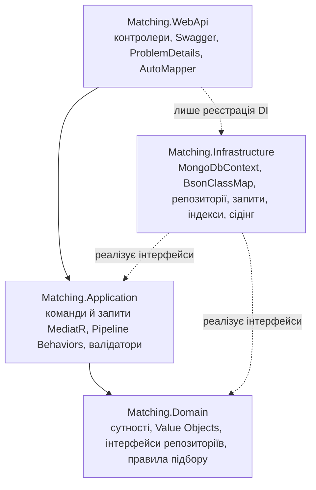

# QPQ.Matching (Лаб. 04, Clean Architecture + CQRS + MongoDB)

Піддомен **Skills**, API **Matching** (Проєкт №3): підбір пар «хто пропонує те, що потрібно іншому». Це read-модель на MongoDB (`QPQ_Matching`): колекції `userSkillIndex` (копія записів UserSkills), `matches` (знайдені пари) і `skillStats` (похідні лічильники). Структура документів визначена в Лаб. 01: [db/p3/matching.collections.js](../../db/p3/matching.collections.js), приклади: [docs/skills-document-examples.md](../../docs/skills-document-examples.md).

Методичка наводить приклад на домені «Відгуки»; тут ті самі прийоми застосовано до власного домену Matching.

## Схема шарів



| Проєкт | Що містить | Залежить від |
|---|---|---|
| `Matching.Domain` | `BaseEntity`, `ValueObject`; сутності `UserSkillIndexEntry`, `Match`, `SkillStats`; Value Objects `Language`, `AvailabilitySlot`, `MatchOffer`, `LanguageCount`; `DomainException`; `IUserSkillIndexRepository`, `IMatchRepository`, `ISkillStatsRepository`; `MatchmakingPolicy` | лише `MongoDB.Bson` (тип `ObjectId`) |
| `Matching.Application` | `ICommand` / `IQuery`, обробники, FluentValidation-валідатори, `LoggingBehavior`, `ValidationBehavior`, `PerformanceBehavior`, інтерфейси читання (`IMatchQueries` ...), DTO | `Domain` |
| `Matching.Infrastructure` | `MongoDbContext`, `MongoMappings` (`BsonClassMap`), репозиторії, реалізації запитів із проєкцією, `IndexCreationService`, сідери | `Application`, `Domain`, `MongoDB.Driver` |
| `Matching.WebApi` | контролери, `GlobalExceptionHandler`, профіль AutoMapper, Swagger, Serilog, health check | `Application`, `Infrastructure` (лише для `AddInfrastructure`) |
| `Matching.Tests` | модульні тести (Domain, Application), інтеграційні тести на справжньому MongoDB, API-тести | усі шари |

Жоден контролер чи обробник Application не звертається до `IMongoCollection` напряму: запис іде через репозиторії з Domain, читання — через `IUserSkillIndexQueries` / `IMatchQueries` / `ISkillStatsQueries` з Application.

## Запуск

Потрібні .NET SDK 10 і MongoDB 5.2 або новіша (потрібен `$sortArray`).

```bash
# MongoDB у контейнері (Docker або Podman)
docker run -d --name qpq-mongo -p 27017:27017 mongo:7

# колекції зі схемою $jsonSchema й індекси з Лаб. 01 (необов'язково: застосунок сам створює індекси й сідінг)
mongosh db/p3/matching.collections.js
mongosh db/p3/matching.seed.js

dotnet run --project Services/Matching/Matching.WebApi        # Swagger: http://localhost:5244/swagger
```

Рядок підключення й назва бази — секція `MongoDb` у `appsettings.{Environment}.json`; параметри пулу й таймаути задаються в самому рядку (`maxPoolSize`, `serverSelectionTimeoutMS`). Під Aspire (`dotnet run --project Platform.AppHost`) рядок бере ресурс `MatchingDb` з `Platform.AppHost/appsettings.json`. Сідінг вмикає `Database:Seed` (true лише в Development, у Production його немає).

MediatR 13+ і AutoMapper 16+ мають комерційну ліцензію з безкоштовною Community-редакцією. Ключ необов'язковий для розробки; якщо він є, його задають через User Secrets:

```bash
dotnet user-secrets set "LuckyPenny:LicenseKey" "<key>" --project Services/Matching/Matching.WebApi
dotnet user-secrets set "AutoMapper:LicenseKey" "<key>" --project Services/Matching/Matching.WebApi
```

Docker-образ: `docker build -f Matching.WebApi/Dockerfile -t qpq-matching-api .` з каталогу `Services/Matching`.

## Домен

| Сутність | Колекція | Особливості |
|---|---|---|
| `UserSkillIndexEntry` | `userSkillIndex` | `Offer` / `Want` (поле `experienceYears` лише в Offer); вбудовані масиви `languages` і `availability` (Value Objects); рівень 1..5; оновлюється за `UserSkillsChanged` |
| `Match` | `matches` | `oneWay` / `mutual` (з `counterOffer`); вбудований `offer` (посилання `indexRef` + знімок `skillName`); статуси `Suggested -> Viewed -> Dismissed`; TTL за `expiresAt` |
| `SkillStats` | `skillStats` | похідна: `_id = skillId`, лічильники за активними записами, три найпоширеніші мови; перераховується агрегацією `$group` + `$merge` |

`BaseEntity` додає `Id` (`ObjectId`), `CreatedAt`, `UpdatedAt` і `Version`. Value Objects (`Language`, `AvailabilitySlot`, `MatchOffer`) незмінні й порівнюються за значеннями. Порушення бізнес-правил кидають `DomainException` ще до звернення до БД.

Правила підбору (`MatchmakingPolicy`): однакова навичка, обидва записи `Active`, рівень пропозиції не нижчий за бажаний, є спільна мова; оцінка 50 + до 10 за мови + 15 за збіг вікон доступності + 25, якщо пара взаємна.

### Зміни схеми db/p3

До `$jsonSchema` додано необов'язкові поля: `createdAt` і `version` у `userSkillIndex`; `updatedAt` і `version` у `matches`. Документи з `matching.seed.js` лишаються валідними (без `version` вважаються версією 0).

## API

| Метод і шлях | Команда / запит | Відповіді |
|---|---|---|
| `GET /api/index-entries?userId&skillId&type&page&pageSize` | `GetIndexEntriesListQuery` | 200, 400 |
| `GET /api/index-entries/{id}` | `GetIndexEntryByIdQuery` | 200 + `ETag`, 400, 404 |
| `POST /api/index-entries` | `CreateIndexEntryCommand` | 201 + `Location`, 400, 409 |
| `PUT /api/index-entries/{id}` (`If-Match`) | `UpdateIndexEntryCommand` | 204 + `ETag`, 400, 404, 409, 428 |
| `DELETE /api/index-entries/{id}` | `DeleteIndexEntryCommand` | 204, 404 |
| `GET /api/matches?userId&includeDismissed&page&pageSize` | `GetMatchesListQuery` | 200, 400 |
| `GET /api/matches/{id}` | `GetMatchByIdQuery` | 200 + `ETag`, 404 |
| `POST /api/matches/generate` | `GenerateMatchesCommand` | 200 (`created`, `upgraded`, `skipped`) |
| `PUT /api/matches/{id}/status` (`If-Match`) | `UpdateMatchStatusCommand` | 204, 400, 404, 409, 428 |
| `GET /api/skill-stats`, `GET /api/skill-stats/{skillId}` | `GetSkillStatsListQuery`, `GetSkillStatsQuery` | 200, 404 |
| `POST /api/skill-stats/rebuild` | `RebuildSkillStatsCommand` | 200 |
| `GET /health` | health check MongoDB | 200 / 503 |

Оптимістична конкурентність: `GET` повертає версію документа в `ETag`, `PUT` передає очікувану версію в `If-Match`. Оновлення виконується лише для документа з цією версією (`ReplaceOne` з фільтром `{ _id, version }`); інакше 409. Без заголовка відповідь 428.

## Pipeline Behaviors

Порядок реєстрації в `Matching.Application/DependencyInjection.cs` визначає порядок виконання: `LoggingBehavior` (зовнішній) -> `ValidationBehavior` -> `PerformanceBehavior` (біля обробника). Некоректна команда відхиляється у `ValidationBehavior`: у лозі є `Handling CreateIndexEntryCommand` і `Request ... failed before completion: ValidationException`, а `Handled` немає, тобто обробник не виконувався. Запити довші за 500 мс потрапляють у лог із попередженням.

## Помилки

`GlobalExceptionHandler` перетворює винятки на `ProblemDetails` (RFC 9457) і логує кожен один раз:

| Виняток | HTTP-статус |
|---|---|
| `NotFoundException` | 404 Not Found |
| `ValidationException` (FluentValidation) | 400 Bad Request (усі помилки разом) |
| `DomainException` | 400 Bad Request |
| `ConflictException` (у т. ч. конфлікт версій) | 409 Conflict |
| `MongoWriteException` / `MongoBulkWriteException` з `DuplicateKey` | 409 Conflict |
| інші помилки запису, `MongoCommandException` з кодом 121 (не пройшла `$jsonSchema`) | 400 Bad Request |
| `MongoConnectionException`, `TimeoutException` (вибір сервера) | 503 Service Unavailable |
| решта | 500 Internal Server Error (деталі лише в Development) |

## Індекси й сідінг

`IndexCreationService` (hosted service) створює індекси при старті з тими самими іменами й параметрами, що в `db/p3/matching.collections.js`, тому повторне створення безпечне:

| Індекс | Призначення |
|---|---|
| `ux_userSkillIndex_userSkillId` (унікальний) | один документ на запис UserSkills |
| `ix_userSkillIndex_skill_type_active` (частковий, `Active`) | пошук активних пропозицій і бажань за навичкою |
| `ix_userSkillIndex_user_status` | усі записи користувача |
| `ux_matches_offer` (унікальний) | одна пара на «хто, кому, яку навичку» |
| `ix_matches_user_status_score` | список пар користувача за оцінкою |
| `ttl_matches_expiresAt` (TTL) | автоматичне видалення застарілих пар |

Сідери (`IDataSeeder`) використовують ті самі дані й `ObjectId`, що `db/p3/matching.seed.js`, і ідемпотентні: якщо колекція не порожня, нічого не додається; `skillStats` наповнюється агрегацією.

## Тести

```bash
# інтеграційним тестам потрібен MongoDB; адреса береться зі змінної QPQ_TEST_MONGO (типово mongodb://localhost:27017)
QPQ_TEST_MONGO=mongodb://localhost:27017 dotnet test Services/Matching/Matching.Tests
```

Без доступного MongoDB інтеграційні й API-тести пропускаються з поясненням, модульні виконуються завжди. Покрито: інваріанти домену (Rating/Level = 10 кидає `DomainException` без БД), Value Objects, статуси пар, правила підбору, `ValidationBehavior` (обробник не викликається), асинхронний валідатор, конфлікт версій, BSON-мапінг (camelCase, приватні поля, незмінні VO), унікальні індекси, ідемпотентний сідінг, агрегацію `skillStats`, пагінацію в MongoDB, коди відповідей API.

## Чекліст перед здачею

- `Matching.Domain` не посилається на інші проєкти (`dotnet list Services/Matching/Matching.Domain reference` порожній).
- Ні контролер, ні обробник Application не використовує `IMongoCollection`.
- `POST /api/index-entries` з `level: 10` повертає 400, а в лозі немає `Handled CreateIndexEntryCommand`.
- У Compass документ `userSkillIndex` має структуру з Лаб. 01 (camelCase, вбудовані `languages` і `availability`, без `_languages` та інших полів .NET).
- `db.userSkillIndex.getIndexes()` та `db.matches.getIndexes()` показують створені індекси; повторний запуск не дублює seed-дані.
- `PUT` зі старою версією в `If-Match` повертає 409; повторний `POST` із тим самим `userSkillId` відхиляється (400 від валідатора або 409 від унікального індексу, не 500).
- `/swagger` показує всі ендпоїнти; знімки екрана: Swagger, документ у Compass, результат `getIndexes()`.
